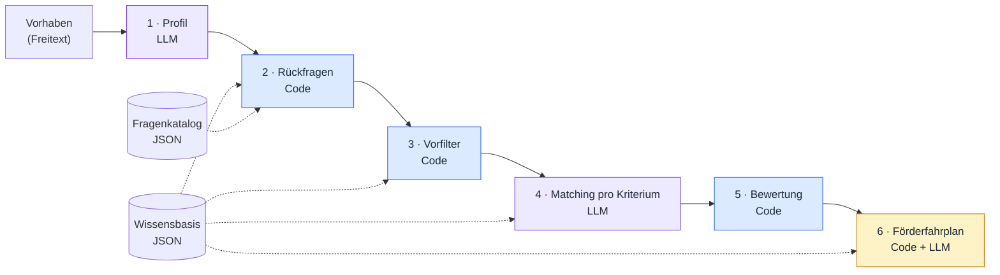

# Fördermittel-Agent Luzern

Ein KI-Agent, der zu einem konkreten Vorhaben eines Luzerner Unternehmens passende Förderprogramme findet und nachvollziehbar erklärt, warum sie passen und was noch fehlt.


> **Orientierungshilfe, keine verbindliche Beurteilung.**
> Der Agent beurteilt die Förderberechtigung nicht verbindlich und ersetzt weder die Prüfung durch die Förderstelle noch eine Beratung. Alle Unternehmensdaten in diesem Repo sind fiktiv.

## Problem und Ansatz

Förderprogramme für Unternehmen im Kanton Luzern sind über Kanton, Region und Bund verteilt. Jedes Programm hat eigene Bedingungen, Fristen und Ausschlüsse. Ein KMU mit einer Projektidee weiss oft nicht, wo es anfangen soll.

Der Agent nimmt eine Beschreibung des Vorhabens in eigenen Worten entgegen, prüft es Kriterium für Kriterium gegen eine kuratierte Wissensbasis und zeigt das Ergebnis mit Quelle. Dabei gilt:

- **Der Code entscheidet, das LLM formuliert.** Filter, Fristen und Bewertung sind deterministischer Code. Das LLM strukturiert Eingaben und schreibt Texte.
- **Ohne Evidenz kein ✓.** Ein Kriterium gilt nur als erfüllt, wenn es im Projektprofil einen Beleg dafür gibt.
- **Jede Aussage hat eine Quelle.** Mit Link und Fundstelle (Randnummer, Ziffer, Artikel).

### Key Features

1. **Förderfahrplan statt Liste**: Programme auf einer Zeitachse. Was ist jetzt zu tun, was später, was kollidiert?
2. **«So wird es passend»**: Bei knappen Treffern zeigt der Agent, welche Änderung das Programm erschliessen würde, z. B. ein Forschungspartner. Nur Hebel, die in der Wissensbasis hinterlegt sind, nichts Erfundenes.
3. **Einblicke für den Kanton**: Eine anonymisierte Auswertung der Anfragen zeigt, was Unternehmen fördern lassen wollen und welche Programme niemand findet.

## So arbeitet der Agent



| Schritt | Wer | Was passiert |
|---|---|---|
| 1 · Profil | LLM | Freitext wird zu einem strukturierten Projektprofil. Jedes Feld ist markiert als *angegeben*, *Annahme* oder *fehlt*. |
| 2 · Rückfragen | Code | Bis zu 10 Fragen, und nur solche, deren Antwort eine Einstufung ändern kann. Pro Profilfeld gibt es genau eine vorab formulierte und geprüfte Frage im Fragenkatalog, darum braucht dieser Schritt kein Modell. |
| 3 · Vorfilter | Code | Nur aktuell beantragbare Instrumente. Falscher Kanton, Gesuchstellertyp, Vorhabenstyp oder Branche fallen weg, mit Begründung. |
| 4 · Matching | LLM | Jedes Kriterium jedes Instruments wird geprüft, mit einer Begründung und dem Beleg aus dem Profil. |
| 5 · Bewertung | Code | Deterministisch: *passt gut*, *passt mit Anpassung / Infos fehlen* oder *passt nicht*. |
| 6 · Förderfahrplan | Code + LLM | Code ordnet nach Frist und Dringlichkeit und prüft Kombinationsregeln. Das LLM formuliert Hinweise und nächste Schritte. |

Alle LLM-Ausgaben sind strukturiertes JSON und werden gegen ein Schema validiert. Rechnen und Fristen übernimmt immer der Code.

### Badges pro Kriterium

| Badge | Bedeutung |
|---|---|
| ✓ | **erfüllt**: im Profil belegt |
| ~ | **Annahme**: plausibel, aber nicht ausdrücklich angegeben |
| ? | **unbekannt**: keine Angabe, Rückfrage nötig |
| ✗ | **nicht erfüllt**: im Profil widerlegt |

## Wissensbasis

Die Programmdaten liegen als JSON in [`knowledge_base/programs/`](knowledge_base/programs/), eine Datei pro Programm. Jede Datei wird gegen das [Schema v2](knowledge_base/schema/program.schema.json) validiert.

```
Programm            Anbieter, Ebene, Zweck, Kombinationsregeln, Quellen
└── Instrumente     Verfügbarkeit, Vorfilter, Förderung, Fristen, Hebel
    └── Kriterien   muss / soll / bewertung, je mit Quelle und Fundstelle
```

Jede Quelle hat Titel, URL, Version und Prüfdatum. Jedes Kriterium verweist auf eine Quelle und eine Fundstelle (`locator`, z. B. `N 51-72` oder `Ziff. 3.3`). Unbekannte Werte sind `null` und werden nicht geraten. Anleitung zum Ergänzen: [`knowledge_base/README.md`](knowledge_base/README.md).

| Programm | Ebene | Anbieter | Instrumente | Quelle | Status |
|---|---|---|---|---|---|
| Luzerner Innovationsbeitrag (LIB) | Kanton | Kanton Luzern, Dienststelle Raum und Wirtschaft (rawi) | 1 | [Handbuch LIB v1.0](https://standortfoerderung.lu.ch/-/media/Standortfoerderung/Dokumente/Handbuch_LIB_2026_10_01.pdf?rev=12a0082f68b34a04a3375117401185d0), [Webseite](https://standortfoerderung.lu.ch/LIB) | erfasst |
| Förderprogramm Energie Kanton Luzern (Gebäudeprogramm) | Kanton | Kanton Luzern, Dienststelle Umwelt und Energie (uwe) | 2 (von 22 Massnahmen) | [Förderbedingungen 2026 v1.2](https://uwe.lu.ch/-/media/UWE/Dokumente/Themen/Energie/Foerderprogramm/Foerderbedingungen_Foerderbeitraege.pdf) | erfasst |
| Innosuisse, Schweizerische Agentur für Innovationsförderung | | | | | geplant |
| Neue Regionalpolitik (NRP), Umsetzung Kanton Luzern | | | | | geplant |
| Startup-Förderung der Standortförderung Kanton Luzern | | | | | geplant |
| InnovationsTransfer Zentralschweiz (ITZ) | | | | | geplant |
| Bürgschaftsgenossenschaft Mitte (BG Mitte) | | | | | geplant |
| Schweizerische Exportrisikoversicherung (SERV) | | | | | geplant |
| Switzerland Global Enterprise (S-GE) | | | | | geplant |
| Innotour (SECO) | | | | | geplant |
| Pronovo, Einmalvergütung für Photovoltaikanlagen | | | | | geplant |

## Abdeckung der Challenge-Anforderungen

| Anforderung | Umsetzung im Konzept | Status |
|---|---|---|
| Vorhaben oder Förderbedarf erfassen | Freitext wird zu einem Profil mit den Markierungen *angegeben / Annahme / fehlt*, korrigierbar durch die Nutzerin oder den Nutzer. | in Arbeit |
| Passende Programme identifizieren | Code-Vorfilter auf der Wissensbasis, danach Prüfung jedes Kriteriums pro Instrument. | in Arbeit |
| Nachvollziehbar erklären, warum ein Programm passt | Pro Kriterium ein Badge, eine Begründung, der Beleg aus dem Profil und die Fundstelle in der Quelle. | in Arbeit |
| Zielgruppe, Zweck, Bedingungen und Fristen strukturiert zeigen | Ergebniskarte pro Programm mit festen Feldern aus der Wissensbasis, Fristen vom Code berechnet. | in Arbeit |
| Zeigen, welche Informationen noch fehlen | Kriterien mit ? werden als offene Punkte gelistet, die wichtigsten als Rückfragen gestellt. | in Arbeit |
| Verfügbare Informationen, Annahmen und Unsicherheiten trennen | Durchgängige Trennung über die Badges ✓ ~ ? ✗ und die Profilmarkierungen; abgelehnte Programme bleiben mit Grund sichtbar. | in Arbeit |

## Repo-Struktur

```
knowledge_base/
  schema/       JSON-Schema v2 für Programmdateien
  programs/     eine JSON-Datei pro Förderprogramm
  sources/      Original-PDFs und gesicherte Quellen pro Programm
  question_catalog.json   eine geprüfte Rückfrage pro Profilfeld
tests/
  projects/     fiktive Testprojekte mit erwarteten Ergebnissen
design/         Entwürfe zu Architektur und Schnittstellen (Vorschlag)
```

## Setup und Start

Programmdateien gegen das Schema validieren:

```
pip install jsonschema
python -c "import json,glob,jsonschema;s=json.load(open('knowledge_base/schema/program.schema.json'));v=jsonschema.Draft202012Validator(s,format_checker=jsonschema.FormatChecker());[print(f,'OK' if not (e:=list(v.iter_errors(json.load(open(f,encoding='utf-8'))))) else [(list(x.path),x.message) for x in e[:5]]) for f in glob.glob('knowledge_base/programs/*.json')]"
```

### Backend

Voraussetzung: [uv](https://docs.astral.sh/uv/). uv installiert Python 3.13 bei Bedarf selbst.

```
cd backend
uv sync                       # installieren
cp ../.env.example .env       # Werte eintragen, die Datei wird nie committet
uv run pytest                 # testen, läuft ohne API-Schlüssel
uv run ruff check . && uv run ruff format --check .
uv run uvicorn app.main:app --reload   # starten, http://localhost:8000/api/health
```

Die Contract-Modelle in `backend/app/models/contract.py` werden aus `design/contract.schema.json` erzeugt: `uv run python scripts/generate_contract_models.py`.

### Frontend

<!-- TODO: Frontend-Setup -->
> Folgt mit dem Frontend.

## Testprojekte

[`tests/projects/`](tests/projects/) enthält fiktive Vorhaben mit erwarteten Programmen und Einstufungen: fünf Standardfälle (u. a. das Sensor-Beispiel aus der Challenge) und drei Grenzfälle (zu vage Eingabe, Unternehmen ausserhalb Luzern, kein passendes Programm).

## Datenschutz und Quellen

- Nur fiktive Unternehmensdaten. Es werden keine realen Firmen gesucht oder abgefragt.
- Nur öffentliche Programminformationen. Jede Quelle ist mit URL, Version und Prüfdatum in der Programmdatei erfasst.
- Auswertungen für den Kanton nur anonymisiert und aggregiert.
- API-Schlüssel gehören in eine lokale `.env` (siehe `.env.example`) und nie ins Repo.

## Team

| Name | Rolle |
|---|---|
| Philipp | Entwicklung |
| Jasper | Entwicklung |
| Johannes | Research und Wissensbasis |
| Julian | Research und Wissensbasis |

## Lizenz

[MIT](LICENSE)
